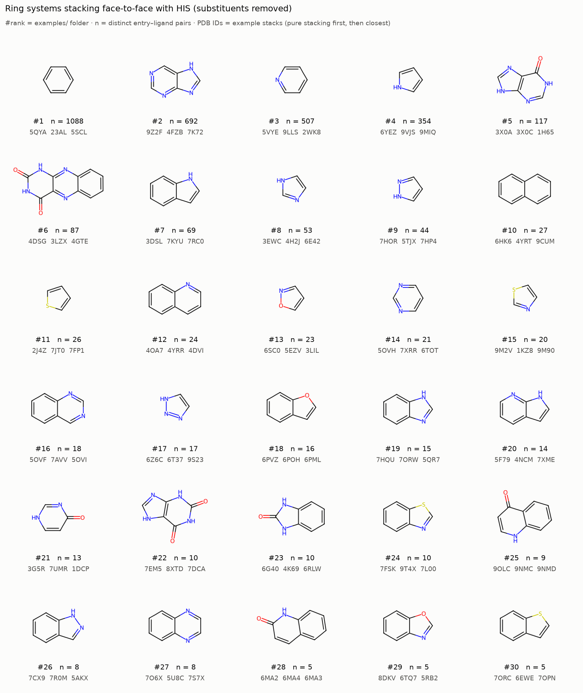

# rcsb-residue-contacts

Find PDB entries in which a **ligand π-stacks on an aromatic residue**, and work out *which ligand
ring patterns* do it. By default the tool looks for **face-to-face stacking with histidine**,
reported separately from polar (H-bond / metal-coordination) contacts with that histidine. PHE,
TYR and TRP are also supported.

Everything comes from the **RCSB PDB web APIs**. There is no local dataset to download, and the
whole archive (every experimental entry, updated weekly) is in scope.

## Example: what stacks face-to-face on histidine?

The figure below comes from a scan of the **whole PDB archive** (`rcsb-residue-contacts
--max-entries -1`, run 2026-11-04). The scan covered every entry (≤ 3.0 Å) in which an aromatic
ligand of interest sits within 5 Å of a histidine: 39,746 entries and 112,500 ligand instances. It
found **6,410 face-to-face His stacks in 3,389 entries**.



Each structure is a ligand ring system with its substituents stripped. `n` counts the distinct
entry–ligand pairs in which that system stacks on a His. The three PDB IDs underneath are example
stacks, pure stacking (no H-bond or metal contact to that His) first. Their pockets are written
to [`examples/HIS-face-to-face/examples/<rank>_…/`](examples/HIS-face-to-face/examples/) as PDB
files you can open directly. Tables and the other plots are in
[`examples/HIS-face-to-face/`](examples/HIS-face-to-face/).

### Whole-archive numbers

| | Count |
| --- | ---: |
| Entries scanned | 39,746 |
| Ligand instances scanned (parsed) | 112,500 (112,476) |
| Distinct entry–ligand pairs / distinct ligands (CCD codes) | 42,943 / 17,380 |
| **Face-to-face His stacks** (entry, ligand instance, His) | **6,410** |
| …in entries / distinct entry–ligand pairs / distinct ligands | 3,389 / 3,426 / 1,704 |
| …released 2020 or later (so not in PDBBind v2020) | 1,446 entries (43%) |
| **Pure stacks** (no H-bond or metal contact to the same His) | **3,544** |
| …in entries / distinct entry–ligand pairs / distinct ligands | 2,079 / 2,095 / 1,107 |
| Stacking ligands that are common cofactors or nucleotides (61 CCD codes: PLP, FAD, NADP, ADP, chlorophyll a, heme, …) | 41% of entry–ligand pairs |
| Other stacking ligands | 1,643 distinct, in 1,998 entries (1,009 of them from 2020 onwards) |

Benzene (1,088 entry–ligand pairs), purine (692) and pyridine (507) are the ring systems that
stack most often; pyrrole (354) comes almost entirely from tetrapyrroles (hemes, chlorophylls and bilins). The most
frequent drug-like stacker is ensitrelvir (`7YY`), which stacks on His41 of SARS-CoV-2 Mpro in 31
entries, every one of them a pure stack. Typical face-to-face geometry is a 3.8 Å centroid
distance, a 13° tilt and a 1.1 Å offset (medians).

**Runtime** (32-core Linux workstation, 8 concurrent requests; the run is limited by network
latency, not compute):

| Step | Time |
| --- | ---: |
| Archive search: one Search API request matching 42,957 ligand entities | seconds to ~1.5 min, depending on RCSB load |
| Entry metadata: 39,746 entries in 795 batched GraphQL requests | 3 min 46 s |
| Coordinates + stacking analysis: 112,500 ligand instances, empty cache | 3 h 35 min |
| **Whole archive, end to end** (including plots and 90 example pockets) | **3 h 40 min** |
| The same run again from the download cache (`.rcsb_cache/`, 3.3 GB) | 8 min 11 s |
| For comparison: a random 2,000-entry sample (`--max-entries 2000`), empty cache | ~15 min |

## How it works

| Step | RCSB service | What it provides |
| --- | --- | --- |
| 1. Discover | [Search API](https://search.rcsb.org/) | Ligand entities that are aromatic (`rcsb_chem_comp_info.bond_count_aromatic`), flagged as the **ligand of interest**, and have the residue type among their precomputed `rcsb_target_neighbors` (closest heavy atom ≤ 5 Å). Optional resolution and release-date filters. One query covers the whole archive. |
| 2. Describe | [Data API](https://data.rcsb.org/) (GraphQL) | Per entry: every ligand instance, its own neighbour list, release date, resolution. Used for per-instance filtering before anything is downloaded. |
| 3. Fetch | [ModelServer](https://models.rcsb.org/) | `/{id}/ligand?label_asym_id=…&encoding=sdf` returns the **ligand instance in its deposited pose, as SDF with CCD bond orders and charges**. `/{id}/atoms?label_comp_id=HIS` returns every histidine. `/{id}/residueSurroundings` returns the pocket used for the example structures. |
| 4. Analyse | local (RDKit, gemmi, NumPy) | Aromatic ring perception, ring-pattern naming, ring-ring stacking geometry, polar/metal flags, SMARTS pharmacophores. |

The ModelServer ligand endpoint is also exposed by the official
[`rcsb-api`](https://rcsbapi.readthedocs.io/) Python package as `ModelQuery.get_ligand()`. This tool
calls the REST endpoints directly with the standard library, which keeps it dependency-free and
lets it cache and parallelise requests.

## Data coverage (Search API counts, 2026-11-04)

| | Entries |
| --- | ---: |
| Experimental PDB entries | 262,513 |
| …released 2020 or later | 103,743 |
| …with a ligand of interest | 136,578 |
| …with an aromatic ligand of interest within 5 Å of a HIS | 44,380 (48,574 ligand entities) |
| …same, at ≤ 3.0 Å resolution (the default search) | 39,746 (42,957 ligand entities) |

Rerun `rcsb-residue-contacts --count-only` (with any filters) for live numbers.

## Installation

```bash
conda env create -f environment.yml   # or: mamba env create -f environment.yml
conda activate rcsb-residue-contacts
```

or `pip install -e .` into an existing environment (Python ≥ 3.10, RDKit, gemmi, pandas,
matplotlib). Network access to `*.rcsb.org` is required.

## Usage

```bash
# Default: HIS, aromatic ligands of interest, ≤ 3.0 Å, random sample of 300 matching entries
rcsb-residue-contacts

# How many entries would a search match? (no downloads)
rcsb-residue-contacts --count-only --released-after 2020-01-01

# Only structures released since 2020, skip common cofactors, bigger sample
rcsb-residue-contacts --released-after 2020-01-01 --exclude-comps HEM,HEA,FAD,FMN,NAD,NAP,ADP,ATP,SAH,SAM \
    --max-entries 2000 --out-dir results/his-2020+

# Specific entries
rcsb-residue-contacts --entries 6PML 1O0H

# The whole archive (~40k entries: ~3.7 h at 8 workers and 3.3 GB of cache; reruns ~8 min)
rcsb-residue-contacts --max-entries -1 --out-dir results/his-all

# Another aromatic residue
rcsb-residue-contacts --residue TRP
```

Key options (`rcsb-residue-contacts --help` lists all of them):

| Option | Default | Meaning |
| --- | --- | --- |
| `--residue` | `HIS` | `HIS`, `PHE`, `TYR` or `TRP` |
| `--max-entries` | `300` | Reproducible random sample of matching entries (`-1` = all) |
| `--released-after` / `--released-before` | – | Initial release date filters (`YYYY-MM-DD`) |
| `--max-resolution` | `3.0` | Resolution cutoff in Å (`0` disables it; NMR entries have no resolution) |
| `--all-ligands` | off | Also include ligands *not* flagged as ligand of interest (cofactors, additives) |
| `--exclude-comps` | – | CCD codes to skip, e.g. `HEM,FAD` |
| `--stack-max-distance` | `5.5` | Max ring centroid distance (Å) |
| `--stack-min-distance` | `3.0` | Min ring centroid distance (Å); closer rings overlap (clash) |
| `--stack-max-angle` | `30` | Max inter-plane angle for face-to-face (°) |
| `--stack-min-t-angle` | `60` | Min inter-plane angle for edge-to-face (°) |
| `--stack-max-offset` | `2.0` | Max lateral centroid offset (Å) |
| `--cache-dir` | `.rcsb_cache` | Download cache: reruns with new thresholds don't hit the network |
| `--workers` | `8` | Concurrent requests to RCSB |

### Stacking criteria

For every aromatic ligand ring (5- or 6-membered, RDKit aromaticity) and every residue ring, the
tool computes the centroid distance *d*, the angle between ring planes *θ*, and the lateral
**offset** (distance between one centroid and the other centroid projected onto its plane, taking
the smaller of the two). These are the [PLIP](https://github.com/pharmai/plip) defaults, plus a
3.0 Å floor on *d*:

| Call | Criteria |
| --- | --- |
| **face-to-face** (sandwich / parallel-displaced) | 3.0 ≤ *d* ≤ 5.5 Å, *θ* ≤ 30°, offset ≤ 2.0 Å |
| **edge-to-face** (T-shaped) | 3.0 ≤ *d* ≤ 5.5 Å, *θ* ≥ 60°, offset ≤ 2.0 Å |
| none | anything else (ring pairs up to 7 Å are still reported, for context) |

Below 3.0 Å the two rings' atoms overlap, so the pair is a clash, not a stack. In the full archive
the floor removes 7 would-be face-to-face pairs (0.9–2.95 Å; the next closest is at 3.05 Å). All
7 involve a histidine with alternate conformations, where the ligand was modelled alongside one
conformation and overlaps the other (see Caveats).

Polar contacts are reported as flags rather than counted as stacking. `polar_contact` means a His
ND1/NE2 is ≤ 3.5 Å from a ligand N or O, and `metal_coordination` means a His N is ≤ 2.8 Å from
a ligand metal. A stack with neither flag is marked **`pure_stacking`**.

## Output

Written under `--out-dir` (default `results/`):

```
results/
├── face_to_face_hits.csv   # THE ANSWER: one row per (entry, ligand instance, residue) face-to-face stack
├── stacking.csv            # every ligand-ring ↔ residue-ring pair within 7 Å, with geometry + call
├── ligands.csv             # every ligand instance scanned (status, rings, contact counts, SMILES)
├── contacts.csv            # SMARTS pharmacophores of ligand atoms ≤ 4 Å from the residue side chain
├── run_info.json           # search query, counts, config, UTC timestamp (for reproducibility)
├── plots/
│   ├── face_to_face_ring_patterns.png  # ligand ring types stacking face-to-face (pure vs + polar contact)
│   ├── face_to_face_ring_systems.png   # top ring systems, each with rank, n and 3 example PDB IDs
│   ├── stacking_geometry.png           # distance vs angle and vs offset for all ring pairs
│   ├── interaction_modes.png           # face-to-face / edge-to-face / polar-only / other, per ligand
│   ├── face_to_face_by_year.png        # hit entries by release year
│   └── contact_pharmacophores.png      # groups in contact: all ligands vs face-to-face stackers
└── examples/
    ├── index.csv                                                   # rank, ring system, file, geometry
    └── <rank>_<ring-system>/<ENTRY>_<LIG>_<asym>__HIS<chain><seq>.pdb
```

`examples/` matches the ring-systems plot. Folder `NN_…` is ring system `#NN` in the grid, and its
(up to) three files are the PDB IDs printed under that structure. Picks favour pure stacks (no
polar/metal contact to the same residue), then the shortest centroid distance, with one per entry.
Each file is the 6 Å pocket from the ModelServer, in the deposited frame, with `REMARK 999` lines
giving the ligand, the residue and the stack geometry. When PDB format can't represent the entry
(5-character CCD codes, long chain IDs), the file is written as `.cif` instead.

Ring patterns name the stacked ring by size and heteroatoms (`benzene`, `pyridine`, `pyrimidine`,
`imidazole`, `thiazole`, …) with `(fused)` when it belongs to a fused system. `ring_system_smiles`
is the whole fused aromatic system with substituents replaced by H (e.g. indole, purine,
benzofuran), in one canonical tautomer and charge state so that, for example, 7H- and 9H-purines
share a name. Plot counts are **distinct (entry, ligand) pairs**, so a ligand bound to every chain
of a homo-oligomer counts once. The CSVs keep every instance.

[`examples/HIS-face-to-face/`](examples/HIS-face-to-face/) holds the full output of the
whole-archive run above (default HIS search, 2026-11-04). To keep the repository small, the three
large tables are gzipped there: `ligands.csv.gz`, `stacking.csv.gz` and `contacts.csv.gz`, 68 MB
uncompressed. `pandas.read_csv` reads them directly.

## Caveats

- **Asymmetric unit, first model, first alt-conformer.** Stacks made across crystal symmetry
  mates or only in the biological assembly are not seen. Residues keep only their first alternate
  conformation, while the ModelServer returns the ligand as modelled. If the ligand was built
  against the residue's *second* conformation, a stack with that conformation is missed, and the
  overlap with the first conformation is caught by the 3.0 Å clash floor.
- **Unparseable ligands** (24 of 112,500 instances in the full run) are reported with
  `status = unparseable`. They are carborane boron clusters and three CCD components with
  impossible valences. Metal complexes are handled: bonds to metals are read as dative bonds.
- **Ligand of interest** is RCSB's annotation (depositor-flagged or computed). `--all-ligands`
  turns the filter off. Cofactors such as heme or FAD are often flagged too; drop them with
  `--exclude-comps`.
- **Prefilter radius.** Instances are kept only if RCSB lists the residue as a neighbour (closest
  heavy atom ≤ 5 Å). A ring pair with every atom more than 5 Å apart cannot pass the stacking
  criteria with a realistic interplanar spacing, so nothing meaningful is lost.
- Partially modelled ligands are analysed as deposited. `heavy_atoms_modelled` vs
  `heavy_atoms_ccd` shows how many atoms are missing.
- The archive grows weekly, so a seeded sample is only reproducible for the same archive state.
  `run_info.json` records the query and the date.
- Unlike PDBBind, the PDB carries binding affinities for only ~9.3k entries
  (`rcsb_binding_affinity`). This tool is structural and does not use affinities.

## Development

```bash
pip install -e ".[dev]"
pytest                          # offline: real RCSB responses for 6PML/2ABE/1XJ6 are in tests/fixtures
RCSB_NETWORK_TESTS=1 pytest     # adds a live end-to-end check against RCSB
```

## License

MIT — see [LICENSE](LICENSE). PDB data are released under CC0 by the wwPDB.
